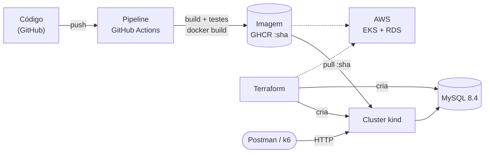

# Workshop Management System

API REST para a gestão de uma oficina mecânica: cadastro de clientes e veículos, abertura e acompanhamento de ordens
de serviço, orçamento com aprovação pelo cliente, execução, estoque e compras. É um monólito modular em Java 21 e
Spring Boot 4, com MySQL, empacotado em uma única imagem que roda no Docker Compose, em Kubernetes (kind) e,
planejado, na AWS.

Projeto do Tech Challenge FIAP (pós-graduação em Software Architecture, turma 17SOAT).

## Objetivos da fase 2

A oficina expandiu para novas unidades e precisa de alta disponibilidade e capacidade para absorver picos de ordens de
serviço. A fase 2 leva a mesma aplicação a uma plataforma orquestrada:

- **APIs do fluxo principal:** abertura completa da OS, consulta de status, aprovação do orçamento por webhook
  assinado, listagem ordenada e notificações por e-mail;
- **Containers e saúde:** imagem única, configuração por variáveis de ambiente, probes de liveness e readiness;
- **Kubernetes:** Deployment, Service, ConfigMap, Secret e HPA, com escala automática sob carga;
- **Infraestrutura como código:** cluster, componente de métricas e banco MySQL criados e destruídos por Terraform;
- **CI/CD:** a cada push, build, testes, imagem publicada no GHCR e deploy num cluster efêmero com smoke test.

## Visão geral



Linhas tracejadas indicam o que está planejado. Na pipeline, o cluster kind puxa a imagem do GHCR pelo SHA do
commit; no PC, a mesma imagem é construída localmente e carregada no kind. Módulos, containers e implantação em
detalhe: [visão geral da arquitetura](docs/architecture/overview.md).

## Início rápido

Pré-requisito: Docker com Docker Compose.

```bash
docker compose up -d --build                              # API, MySQL, Mailpit e simulador do fornecedor
curl http://localhost:8080/actuator/health/readiness      # {"status":"UP"} quando estiver pronta (~3 min)
```

Depois, abra o Swagger em `http://localhost:8080/swagger-ui.html`, faça login em `POST /api/auth/login` com a conta
de bootstrap `admin` / `changeme123` e use o token no botão **Authorize**. Os e-mails enviados aparecem no Mailpit, em
`http://localhost:8025`.

> A conta `admin` é criada por migration em todos os ambientes. Troque a senha fora de um ambiente de demonstração.

## Documentação

| Quero... | Leia |
| --- | --- |
| Entender a arquitetura (contexto, módulos, implantação, ADRs) | [Visão geral da arquitetura](docs/architecture/overview.md) |
| Rodar localmente com Docker Compose | [Execução local com Docker Compose](docs/setup/local-docker-compose.md) |
| Rodar no Kubernetes local com Terraform | [Ambiente Kubernetes local](docs/setup/local-kubernetes.md) |
| Ver o HPA escalar sob carga | [Teste de carga e HPA](docs/operations/load-testing-hpa.md) |
| Configurar variáveis de ambiente e segredos | [Configuração](docs/setup/configuration.md) |
| Entender a pipeline e os workflows | [CI/CD](docs/operations/ci-cd.md) |
| Consumir a API e testar o fluxo completo | [API](docs/api/README.md) e [teste manual pelo Postman](docs/api/manual-testing.md) |
| Contribuir com código | [CONTRIBUTING.md](CONTRIBUTING.md) e [AGENTS.md](AGENTS.md) |
| Ver tudo, organizado por público | [Índice da documentação](docs/README.md) |

## Stack

| Camada | Tecnologia |
| --- | --- |
| Aplicação | Java 21, Spring Boot 4.1, Spring Modulith 2.1, Spring Data JPA, Spring Security (JWT e HMAC) |
| Banco | MySQL 8.4, migrations com Flyway |
| Qualidade | JUnit, MockMvc, JaCoCo (mínimo de 80%), Postman/Newman, OWASP Dependency-Check e ZAP |
| Containers | Docker (build multi-stage, usuário não-root), Docker Compose |
| Kubernetes | kind, Kustomize, HPA, metrics-server |
| Infraestrutura | Terraform (providers kind, Helm, Kubernetes) |
| CI/CD | GitHub Actions, GitHub Container Registry (GHCR) |

## Estrutura do repositório

| Caminho | Conteúdo |
| --- | --- |
| `src/` | Código e testes da aplicação |
| `k8s/` | Manifestos Kubernetes: `base/` e `overlays/` por ambiente (Kustomize) |
| `infra/` | Terraform, uma pasta por stack (`local/cluster`, `local/database`) |
| `load-test/` | Script k6 do teste de carga |
| `docker/` | Arquivos de apoio dos containers (mapeamentos do simulador do fornecedor) |
| `docs/` | Documentação, ADRs, especificações de features e collection Postman |
| `.github/workflows/` | CI (`ci.yml`), entrega (`cd.yml`) e scan de segurança |

## Status da fase 2

- [x] APIs do fluxo principal e testes dos fluxos críticos
- [x] Dockerfile, Docker Compose e health checks
- [x] Terraform local: cluster kind, metrics-server e MySQL
- [x] Manifestos Kubernetes com HPA e teste de carga
- [x] Pipeline de entrega com cluster efêmero e smoke test
- [ ] Ambiente AWS Academy (EKS + RDS)
- [ ] Vídeo de demonstração e PDF de entrega
